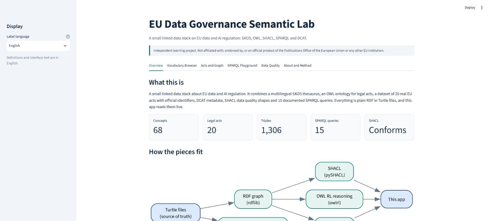
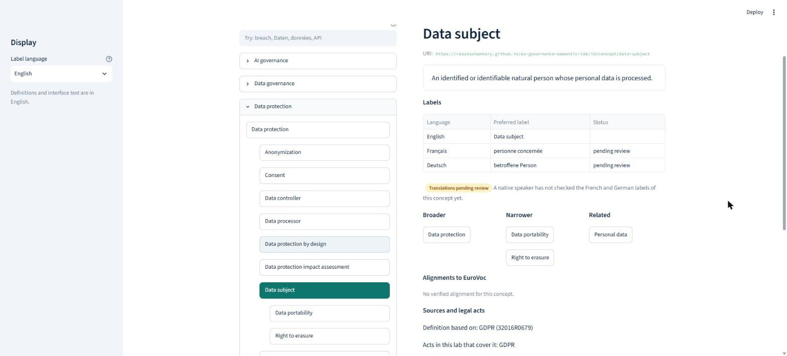
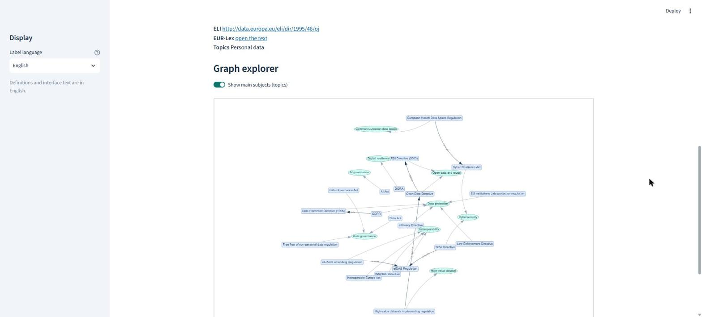
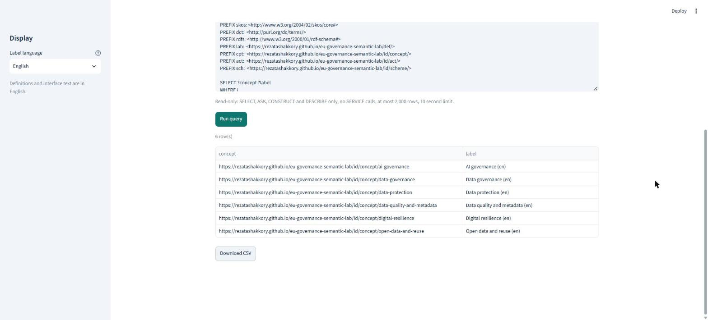
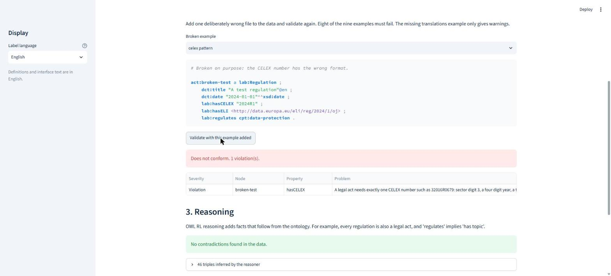
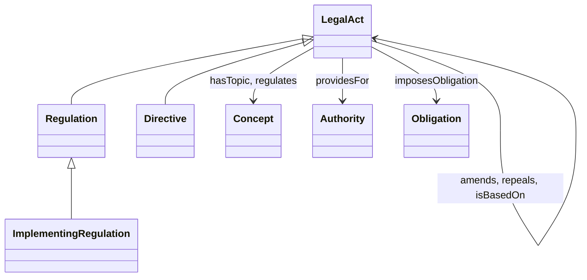

# EU Data Governance Semantic Lab

[](https://github.com/rezatashakkory/eu-governance-semantic-lab/actions/workflows/ci.yml)


A small linked data stack about EU data and AI regulation. It combines a multilingual SKOS thesaurus (68 concepts in English, French and German), an OWL ontology for legal acts, a dataset of 20 real EU acts with CELEX numbers and ELI identifiers that were checked against the public Cellar endpoint, a DCAT-style catalog, SHACL data quality shapes, 15 documented SPARQL queries, and a web app to explore all of it. Everything is plain Turtle in git, and the app reads the files live.

> **Disclaimer.** This is an independent learning project. It is not affiliated with, endorsed by, or an official product of the Publications Office of the European Union or any other EU institution. It uses only public sources and no EU logos or brand colors. Definitions are plain-language explanations, not legal text.



## See it in 2 minutes

```bash
python -m venv .venv
# Windows PowerShell: .venv\Scripts\Activate.ps1
# macOS and Linux:    source .venv/bin/activate
python -m pip install -e ".[dev,app,docs]"
python -m semlab validate                     # SHACL: conforms
python -m streamlit run app/streamlit_app.py  # open http://localhost:8501
```

Requires Python 3.11 or newer. No database, no internet needed to run the app. Building the ontology page with `make docs` needs Python 3.12 or newer.

| | |
| --- | --- |
|  |  |
| **Vocabulary Browser.** Search in any language, a tree, definitions, translation status, EuroVoc links. | **Acts and Graph.** 20 acts and how they amend, repeal and cover topics. |
|  |  |
| **SPARQL Playground.** 15 documented queries, read-only, with CSV download. | **Data Quality.** Live SHACL report, and a demo that breaks the data on purpose. |

## What is inside

| Part | Where | Standard |
| --- | --- | --- |
| Thesaurus, 68 concepts, 6 groups, labels in 3 languages, 19 links to EuroVoc | `data/vocabulary/` | SKOS |
| Ontology for legal acts, with a reasoning demo | `data/ontology/`, `docs/ontology.html` | OWL 2 |
| 20 EU acts with identifiers, topics and relations | `data/dataset/legal-acts.ttl` | RDF |
| Catalog of 3 datasets and 9 distributions | `data/dataset/catalog.ttl` | DCAT |
| Data quality rules and 9 broken examples | `data/shapes/`, `tests/data/` | SHACL |
| 15 documented queries from easy to advanced | `queries/` | SPARQL 1.1 |
| JSON-LD and RDF/XML, generated from the Turtle | `data/dist/` | |
| Web app, 6 tabs | `app/` | Streamlit |
| Optional live check against Cellar | `src/semlab/cellar.py` | |

## How it fits together

```mermaid
flowchart LR
    ttl["Turtle files<br/>source of truth"] --> graph["RDF graph<br/>rdflib"]
    graph --> shacl["SHACL<br/>pySHACL"]
    graph --> owl["OWL RL reasoning<br/>owlrl"]
    graph --> sparql["SPARQL<br/>15 queries"]
    ttl --> dist["JSON-LD and RDF/XML<br/>data/dist"]
    shacl --> app["Streamlit app"]
    owl --> app
    sparql --> app
    cellar["Cellar endpoint<br/>public, optional"] -.-> verify["verify-acts"]
    ttl -.-> verify
```

The ontology, in one picture. Topics are concepts of the thesaurus (`skos:Concept`).



`Regulation` and `Directive` are disjoint, `regulates` is a sub-property of `hasTopic`, and `amends` and `repeals` are asymmetric with inverses `amendedBy` and `repealedBy`. Details are in [docs/modeling_decisions.md](docs/modeling_decisions.md).

## Commands

| Task | Command | With make |
| --- | --- | --- |
| Install | `python -m pip install -e ".[dev,app,docs]"` | `make setup` |
| Lint | `python -m ruff check .` and `python -m ruff format --check .` | `make lint` |
| Tests | `python -m pytest` | `make test` |
| SHACL validation and generated files | `python -m semlab validate` and `python -m semlab check-dist` | `make validate` |
| Regenerate JSON-LD and RDF/XML | `python -m semlab build` | `make build` |
| Ontology page and translation list | `python -m pylode data/ontology/legal-acts.ttl -o docs/ontology.html` and `python -m semlab translations` | `make docs` |
| App | `python -m streamlit run app/streamlit_app.py` | `make app` |
| All checks | | `make all` |

More: `python -m semlab queries 11` runs one query, `python -m semlab reason` shows what OWL reasoning adds, and `python -m semlab verify-acts` compares the 20 acts with the live Cellar data (needs internet).

## What was verified

- The 20 acts, their CELEX numbers, ELI identifiers, titles, dates and 6 legal relations were checked against the Cellar SPARQL endpoint of the Publications Office on 3 November 2026. `verify-acts` repeats the check.
- The 19 EuroVoc identifiers and the language, theme, file type, license and frequency codes were looked up in the official data.
- SHACL passes on the real data and fails on 8 of the 9 deliberately broken examples (the ninth gives warnings only).
- Each of the 15 queries has a test for its documented result.

## Known limits

- **Translations.** French and German labels that do not come from EuroVoc (58 of 68 concepts) are marked `lab:pendingReview`. See [docs/translations_to_review.md](docs/translations_to_review.md).
- **No content negotiation.** The URIs sit on a static GitHub Pages address, so they name things but do not return RDF by themselves. The files are in `data/dist`.
- **EuroVoc links** are the author's judgment and should be reviewed by an expert. EuroVoc labels keep EuroVoc's own terms, see [docs/sources_and_licenses.md](docs/sources_and_licenses.md).
- **DCAT-AP style, not certified.** No official DCAT-AP validation was run.
- **Definitions** cite whole acts, not articles.
- `make` is not installed on the Windows development machine. The Makefile is run by CI on Linux for Python 3.11 and 3.12, and on Windows you can run the plain commands in the table above.

## Documentation

| For | Read |
| --- | --- |
| Learning the whole project | [STUDY_GUIDE.md](STUDY_GUIDE.md), [LEARNING_NOTES.md](LEARNING_NOTES.md) |
| Presenting it | [DEMO_SCRIPT.md](DEMO_SCRIPT.md), [INTERVIEW_QA.md](INTERVIEW_QA.md) |
| Non-technical users | [docs/guide_for_non_technical_users.md](docs/guide_for_non_technical_users.md), [docs/training_workshop_30min.md](docs/training_workshop_30min.md) |
| Maintaining the data | [docs/how_to_add_a_concept.md](docs/how_to_add_a_concept.md), [docs/translations_to_review.md](docs/translations_to_review.md) |
| Design reasons and sources | [docs/modeling_decisions.md](docs/modeling_decisions.md), [docs/sources_and_licenses.md](docs/sources_and_licenses.md) |
| Queries line by line | [docs/sparql_walkthrough.md](docs/sparql_walkthrough.md) |

## Future work

- Native speaker review of the French and German labels.
- Article-level citations for definitions.
- Publishing with content negotiation, or a persistent redirect for the URIs.
- An Apache Jena Fuseki endpoint with Docker Compose.
- A live Cellar view in the app.
- Registering the catalog in a data portal and running a formal DCAT-AP validation.

## License

Code is MIT, see [LICENSE](LICENSE). Data, queries and documentation are CC BY 4.0. EuroVoc labels keep their own terms, see [docs/sources_and_licenses.md](docs/sources_and_licenses.md).
