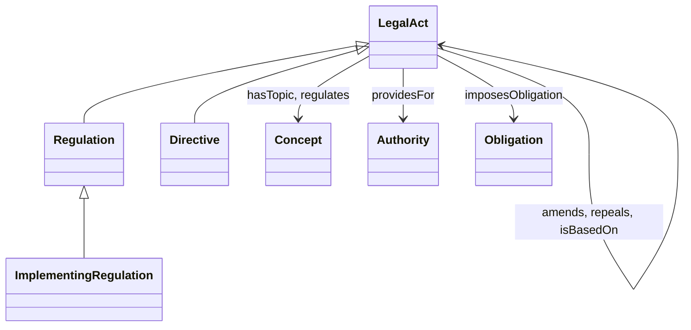

# Study guide: understand this project properly and simply

Read this in two sittings of about two hours each. Every idea is explained in plain words and then shown with a real example from this repository. Type the commands as you read. Understanding by doing is faster than rereading.

**Plan.**
- **Sitting 1:** Parts 1 to 5. The ideas: RDF, URIs, SKOS, OWL.
- **Sitting 2:** Parts 6 to 10. The data, SPARQL, SHACL, the code, the app. Then Part 12, the self-test.
- **Before the interview:** read `DEMO_SCRIPT.md` and `INTERVIEW_QA.md`, and write the three queries in Part 7 yourself.

**Setup.** Open a terminal in the project folder, then:

```powershell
.\.venv\Scripts\Activate.ps1        # Windows. On macOS or Linux: source .venv/bin/activate
python -m semlab queries            # should list 15 queries
```

---

## Part 1. The big picture in one minute

Imagine a small library about EU data and AI law.

| In the library | In this project | Standard |
| --- | --- | --- |
| The **subject catalog**: agreed terms with translations and "see also" links | The thesaurus of 68 concepts | **SKOS** |
| The **rules about the kinds of things** and how they relate ("a regulation is a legal act", "an act can amend another act") | The ontology | **OWL** |
| The **list of books** | The dataset of 20 EU acts | **RDF** |
| The **catalog card for the catalog itself**: who published it, under which license, where to download it | The catalog description | **DCAT** |
| The **inspector** who checks that every card is complete | The data quality rules | **SHACL** |
| The **librarian** who answers questions | The 15 queries | **SPARQL** |

All of it is stored as plain text files in one format, RDF, so the pieces can point to each other. For example, the GDPR (a "book") points to the concept *Personal data* (a "subject heading"). This is what **linked data** means: data that links to other data using shared names.

The whole stack in one line: **Turtle files -> RDF graph in memory -> checked by SHACL, extended by OWL reasoning, queried by SPARQL -> shown in a web app.**

---

## Part 2. RDF in five minutes

### A fact is a sentence with three parts

RDF stores facts as **triples**: subject, predicate (also called property), object.

> GDPR `has topic` Personal data

- The **subject** is the thing you talk about.
- The **predicate** is the relation or attribute.
- The **object** is either another thing or a plain value (a **literal**, like the text "Data subject").

A set of triples is a **graph**: things are dots, predicates are labeled arrows. If you know Neo4j, this is the same picture with two differences. In RDF, every dot and arrow has a **global name** (a URI), and an arrow cannot carry properties of its own.

### Names are URIs

A **URI** is a global name, usually written like a web address. `https://rezatashakkory.github.io/eu-governance-semantic-lab/id/concept/data-subject` names the concept *Data subject*. It names a thing, it is not necessarily a page you can open. Because names are global, my data can point to a concept in your data without a shared database.

Long names are shortened with **prefixes**. `cpt:data-subject` means "the prefix `cpt:` plus `data-subject`".

### Turtle is the readable way to write triples

```turtle
@prefix cpt:  <https://rezatashakkory.github.io/eu-governance-semantic-lab/id/concept/> .
@prefix skos: <http://www.w3.org/2004/02/skos/core#> .

cpt:data-subject a skos:Concept ;
    skos:prefLabel "Data subject"@en ,
                   "betroffene Person"@de ;
    skos:broader cpt:data-protection .
```

Four tricks make it short:
- `a` means "is a" (it is `rdf:type`).
- `;` means "same subject, next property".
- `,` means "same subject and property, another value".
- `@en` and `@de` are **language tags** on text.

That block is **four triples**: one for the type (`a`), one for each of the two labels, and one for `broader`. Count them yourself, it is the best way to check you read Turtle correctly.

### Try it

```powershell
python -c "from semlab import load_all; g = load_all(); print(len(g), 'triples')"
```

You should see `1306 triples`: the thesaurus, the ontology, the acts and the catalog together.

**In this repository, Turtle is the source of truth.** The files in `data/dist` (JSON-LD and RDF/XML) are generated from it by `python -m semlab build`.

---

## Part 3. Linked data and the URI design

### The four principles (Tim Berners-Lee, 2006)

1. Use URIs as names for things.
2. Use HTTP URIs so people can look them up.
3. When someone looks up a URI, return useful information in a standard format (RDF).
4. Include links to other URIs so people can discover more.

### What this project does about them

- **Principle 1 and 4: yes.** Everything has a URI, and the data links to EuroVoc, to ELI and to EUR-Lex.
- **Principle 2: yes in form.** The URIs start with `https://`.
- **Principle 3: only partly.** The URIs live on GitHub Pages, a static site. A static site cannot do **content negotiation**, which is a server choosing to return Turtle to a program and HTML to a browser. So the files are published in `data/dist`, but the URIs do not return them by themselves. This is written down honestly in `docs/modeling_decisions.md` (D4). Real services such as the Publications Office do negotiate content.

### The URI patterns used here

| Kind | Pattern | Example |
| --- | --- | --- |
| Ontology terms | `/def/Name` | `/def/LegalAct` |
| Concepts | `/id/concept/slug` | `/id/concept/data-protection` |
| Acts | `/id/act/CELEX` | `/id/act/32016R0679` |

Remember the logic: **the label can change, the URI should not.** That is why the slug is a plain English word and the label lives in data.

---

## Part 4. SKOS, the thesaurus

SKOS (Simple Knowledge Organization System) is a W3C standard for vocabularies, thesauri and classification schemes. It is **not logic**. It is a way to describe terms and how they relate.

### The pieces

| SKOS term | What it means | Example in this project |
| --- | --- | --- |
| `skos:ConceptScheme` | The whole vocabulary | `sch:eu-data-governance` |
| `skos:Concept` | One idea | `cpt:data-subject` |
| `skos:prefLabel` | The one main name in a language | "Data subject"@en |
| `skos:altLabel` | Other names: synonyms, abbreviations, spelling variants | "DPIA" for the impact assessment |
| `skos:definition` | A definition | "An identified or identifiable natural person ..." |
| `skos:broader` / `skos:narrower` | One step up or down | *Personal data* is narrower than *Data protection* |
| `skos:related` | Associated, but neither above nor below | *Data controller* and *Data processor* |
| `skos:hasTopConcept` | Entry points of the hierarchy | the six top concepts |
| `skos:exactMatch`, `closeMatch`, `broadMatch` | Links to concepts in **other** vocabularies | links to EuroVoc |

### Three things people get wrong

1. **Broader is not "is a".** *Right to erasure* sits under *Data subject*, but a right is not a kind of person. Broader means "belongs under, for navigation". If you need real "is a" logic, use OWL.
2. **Exactly one preferred label per language.** Other names go in `altLabel`. Our SHACL shape enforces this.
3. **`related` goes both ways.** If A is related to B, write B related to A too. A test checks it.

### A real concept, simplified from `data/vocabulary/eu-data-governance.ttl`

```turtle
cpt:data-subject a skos:Concept ;
    skos:inScheme sch:eu-data-governance ;
    skos:prefLabel "Data subject"@en, "personne concernée"@fr, "betroffene Person"@de ;
    skos:definition "An identified or identifiable natural person whose personal data is processed."@en ;
    skos:broader cpt:data-protection ;
    skos:narrower cpt:data-portability, cpt:right-to-erasure ;
    skos:related cpt:personal-data ;
    dct:source act:32016R0679 ;
    lab:pendingReview "fr", "de" .
```

Read it line by line:
1. It is a concept.
2. It belongs to our scheme.
3. Its preferred label in three languages.
4. Its definition (in English only).
5. It sits under *Data protection*.
6. Two concepts sit under it.
7. It is associated with *Personal data*.
8. Its definition is based on the GDPR, the act `32016R0679`.
9. Its French and German labels have not been checked by a native speaker.

### Linking to EuroVoc

**EuroVoc** is the multilingual thesaurus of the EU institutions, maintained by the Publications Office. We link 19 of our concepts to it:

- `exactMatch` (10): the same meaning. *Data protection*, *Personal data*, *Open data*, *Metadata* and others.
- `closeMatch` (4): very close, but not interchangeable. *AI system* and the EuroVoc concept *artificial intelligence*: one is a system, the other is a field.
- `broadMatch` (5): the EuroVoc concept is broader than ours. *ICT risk management* and *risk management*.

Every one of these 19 identifiers was looked up in the official data. For the 10 concepts with an exact match, the French and German labels are the EuroVoc labels, so they are not flagged for review. **The choice of match type is my judgment.** Say so if asked.

### Try it

```powershell
python -m semlab queries 9      # the 19 links to EuroVoc
python -m semlab queries 5      # everything below Data protection
```

---

## Part 5. OWL, the ontology

### What it is for

OWL (Web Ontology Language) describes **classes** (kinds of things), **properties** (relations) and rules about them, so that a program can *infer* new facts and *detect contradictions*.

Our ontology is small on purpose. Open `data/ontology/legal-acts.ttl` and `docs/ontology.html` (generated with pyLODE) next to this guide.

### The model



(`Concept` is `skos:Concept`: the topics come from the thesaurus.)

### The vocabulary of OWL, with our examples

| Idea | Meaning | In this ontology |
| --- | --- | --- |
| **Class** | A kind of thing | `LegalAct`, `Regulation`, `Directive`, `Authority`, `Obligation` |
| **Subclass** | Every X is also a Y | every `Regulation` is a `LegalAct` |
| **Object property** | Links two things | `amends` links an act to an act |
| **Datatype property** | Links a thing to a value | `hasCELEX` links an act to a text |
| **Domain** | The kind of thing at the start of the link | `amends` starts at a `LegalAct` |
| **Range** | The kind of thing at the end | `amends` ends at a `LegalAct` |
| **Inverse** | The same link read backwards | `amends` and `amendedBy` |
| **Asymmetric** | If A amends B, B cannot amend A | `amends`, `repeals` |
| **Functional** | At most one value | an act has exactly one `hasCELEX` |
| **Sub-property** | Every use of P is also a use of Q | `regulates` is a sub-property of `hasTopic` |
| **Disjoint** | Nothing can belong to both classes | `Regulation` and `Directive`; `LegalAct`, `Authority` and `Obligation` |

### Reasoning: what the computer adds

A **reasoner** applies those rules to derive triples that nobody wrote down. We use `owlrl`, a small reasoner for the OWL RL profile.

```powershell
python -m semlab reason
```

You see `1306 triples asserted, 46 new triples inferred`. The three kinds of inference you should be able to explain:

1. **Subclass.** The data says `GDPR a Regulation`. The ontology says every Regulation is a LegalAct. So it adds `GDPR a LegalAct`.
2. **Inverse.** The data says `GDPR repeals Directive 95/46`. So it adds `Directive 95/46 repealedBy GDPR`.
3. **Sub-property.** The data says `GDPR regulates Data protection`. So it adds `GDPR hasTopic Data protection`.

And one **contradiction check**. If someone writes that the GDPR is also a Directive, the reasoner reports: *Disjoint classes Regulation and Directive have a common individual 32016R0679*. A test does exactly this.

### Open world, in one paragraph

OWL assumes **we do not know everything**. If an act has no `hasTopic`, OWL does not call that wrong, it just does not know. That is why OWL cannot be used to *require* that data is complete. SHACL does that job (Part 8).

### When to use SKOS and when OWL

| Question | SKOS | OWL |
| --- | --- | --- |
| What do you describe? | Terms and their meaning | Things and how they relate |
| Typical content | Labels in many languages, definitions, broader and narrower | Classes, properties, rules |
| Does it support inference? | Almost none | Yes |
| Hierarchy means | "Belongs under" | "Is a kind of" |
| Who uses it | Librarians, terminologists, content teams | Modelers, data engineers |
| Example | EuroVoc | The legal acts ontology here |

In this project they meet at one point: `lab:hasTopic` goes from an act (OWL world) to a concept (SKOS world).

---

## Part 6. The dataset, DCAT, open data, FAIR

### The 20 acts

`data/dataset/legal-acts.ttl` has 20 acts: GDPR, AI Act, Data Governance Act, Data Act, DORA, NIS2, Open Data Directive, Cyber Resilience Act, European Health Data Space Regulation, and others. For each: the official English **title**, the **document date**, the **CELEX number**, the **ELI**, a link to EUR-Lex, the topics it covers, and its relations to other acts.

- **CELEX** is the identifier EUR-Lex gives to each act. `32016R0679` means: sector 3 (legislation), year 2016, type **R** (regulation), number 0679. `L` is a directive.
- **ELI** (European Legislation Identifier) is a permanent web address for legislation, for example `http://data.europa.eu/eli/reg/2016/679/oj`.

### How these facts were verified

Not from memory. Each CELEX, ELI, title and date was queried from **Cellar**, the Publications Office repository behind EUR-Lex, through its public SPARQL endpoint. The six legal relations (three amends, two repeals, one is based on) came from the same place. You can repeat the check yourself:

```powershell
python -m semlab verify-acts      # needs internet, compares all 20 acts to the live data
```

### DCAT: describing datasets so others can find them

**DCAT** (Data Catalog Vocabulary) is the W3C standard for describing datasets. **DCAT-AP** is the European application profile of it, used by data.europa.eu and national portals. Our file `data/dataset/catalog.ttl` is **DCAT-AP style**: it follows the structure but does not claim formal conformance.

Three levels:

| Class | What it is | Here |
| --- | --- | --- |
| `dcat:Catalog` | A collection of dataset descriptions | one catalog |
| `dcat:Dataset` | One dataset | thesaurus, ontology, acts: three datasets |
| `dcat:Distribution` | One downloadable form of a dataset | Turtle, JSON-LD, RDF/XML: three each, nine in all |

Each dataset says: title, description, **publisher**, **license**, language, theme, keywords, dates, how often it changes. The language, theme, file-type and license values use the **EU Vocabularies code lists**, such as `.../authority/licence/CC_BY_4_0`. Using shared codes instead of free text is the whole point: other portals understand them.

### Open data, FAIR, licensing

**Open data** is data anyone can use and share, with at most small conditions such as naming the source. **FAIR** means **F**indable, **A**ccessible, **I**nteroperable, **R**eusable. How this project meets it, honestly:

| FAIR | What is done | What is missing |
| --- | --- | --- |
| Findable | Persistent URIs, rich metadata in DCAT | Not yet registered in a portal |
| Accessible | Files in the open repository | URIs do not negotiate content (static site) |
| Interoperable | Standard vocabularies (SKOS, OWL, DCAT, Dublin Core), links to EuroVoc and ELI | |
| Reusable | CC BY 4.0 for data, MIT for code, sources documented | EuroVoc labels keep EuroVoc's own terms |

**Licenses.** Code is MIT. Data is **CC BY 4.0**, which means "use it for anything, but credit the author". `docs/sources_and_licenses.md` explains what comes from where. Note the exception: the ten pairs of EuroVoc labels stay under EuroVoc's terms.

---

## Part 7. SPARQL

SPARQL is the query language of RDF. You write a **pattern of triples with variables**, and the engine returns every way of filling the variables.

```sparql
SELECT ?concept ?label
WHERE {
  ?concept skos:broader cpt:data-protection ;
           skos:prefLabel ?label .
  FILTER (lang(?label) = "en")
}
```

Read it as: "find every concept whose broader concept is Data protection, and its English label."

### The ten techniques you need

| Technique | What it does | Query |
| --- | --- | --- |
| Triple pattern | Match a fact | 01 |
| `FILTER` | Keep rows that meet a condition | 01, 03 |
| `OPTIONAL` | Keep the row even if this part is missing | 02 |
| `ORDER BY`, `DISTINCT` | Sort, remove duplicates | 03, 10 |
| Property path `+` and `*` | Follow a link repeatedly | 05, 06, 11 |
| `GROUP BY`, `COUNT` | Count per group | 07, 13 |
| `FILTER NOT EXISTS` | Find what is **missing** | 08, 14 |
| `VALUES`, `BIND` | Fixed values, computed columns | 08, 09 |
| `UNION` | Combine alternatives | 12 |
| `ASK`, `CONSTRUCT` | Yes or no, build a new graph | 14, 15 |

`docs/sparql_walkthrough.md` explains six queries line by line.

### Two data quality queries you should be able to explain

- **Query 08** finds concepts missing a French or German label. It returns **no rows** now, and no rows is the good answer.
- **Query 14** asks yes or no: is any concept missing a definition? The answer is **false**.

### Your turn: write three queries yourself

Do this before the interview. It changes how you talk about the project. Use the playground in the app, or the file `queries/` as a style guide. Answers are in `docs/sparql_walkthrough.md`, at the end.

1. Which acts regulate *Cybersecurity*?
2. Which concepts have an alternative label?
3. Which concepts have an `exactMatch` to EuroVoc **and** a source act?

Then try two harder ones without help:

4. List the acts that were adopted in 2022 (use `dct:date` and `YEAR()`; or `FILTER (?date >= "2022-01-01"^^xsd:date && ?date < "2023-01-01"^^xsd:date)`).
5. For each top concept, how many acts regulate it directly (`lab:regulates`)? Many top concepts will have zero, which is itself informative.

---

## Part 8. SHACL, the quality rules

**SHACL** (Shapes Constraint Language) describes what valid data looks like, then checks data against it. A **shape** says things like: "every concept must have an English label".

```powershell
python -m semlab validate
```

Output: `SHACL: conforms, 0 violations, 0 warnings`.

### Our rules (all in `data/shapes/shapes.ttl`)

| About | Rule |
| --- | --- |
| Concept | Belongs to exactly one scheme; has an English preferred label; at most one preferred label per language; has a definition; its preferred label is not used by another concept in the same language; broader and narrower links mirror each other |
| Concept (Warning) | Has a French label and a German label |
| Scheme | Has a title and at least one top concept |
| Legal act | Exactly one CELEX that matches `^3[0-9]{4}[A-Z][0-9]{4}$`; an English title; one date of type date; an ELI starting with `http://data.europa.eu/eli/`; at least one regulated subject; topics are real concepts; the CELEX letter matches the class (R is a regulation, L is a directive) |
| Dataset | Has title, description, **publisher**, **license**, language, theme, issued date of type date, and at least one distribution |
| Distribution | Has an access URL, a format and a license |
| Catalog and agent | Title, description, publisher, a dataset; an agent has a name |

**Severity.** A *violation* fails the check. A *warning* is reported but does not fail it. Missing French or German labels are warnings, because translation can lag behind.

### Negative tests: proof that the rules bite

A rule that never fails proves nothing. The folder `tests/data` has nine small files, each **broken on purpose**: a concept without an English label, a duplicate label, a bad CELEX number, a dataset without license and publisher, and so on. Eight of them must **fail with the right message**. The ninth, missing translations, is only a warning and must **still pass**. The tests check both. You can try them live in the app, tab Data Quality, section *Break the data on purpose*.

### SHACL versus OWL, the question you will be asked

| | OWL | SHACL |
| --- | --- | --- |
| Purpose | Infer new facts, find contradictions | Check that data is complete and well formed |
| World view | **Open**: missing means unknown | **Closed**: missing means an error |
| Example | "Every Regulation is a LegalAct" adds a triple | "Every act needs a CELEX" reports an error |
| Result | More triples | A validation report |

Use OWL to say what things **mean**. Use SHACL to say what data **must contain**.

---

## Part 9. The code in one page

```
data/            the Turtle files (source of truth) and generated files in dist/
queries/         15 documented SPARQL files
src/semlab/      the Python package, one small module per job
app/             the Streamlit web app
tests/           pytest tests and tests/data with the broken examples
docs/            guides, decisions, sources
```

| Module in `src/semlab/` | One line |
| --- | --- |
| `namespaces.py` | The base URI and short prefixes (`lab`, `cpt`, `act`) |
| `loading.py` | Finds the files and loads them into one rdflib graph |
| `validation.py` | Runs SHACL, returns a readable list of findings |
| `reasoning.py` | Runs OWL RL, lists what was inferred, detects contradictions |
| `queries.py` | Reads the `.rq` files and runs queries safely: read-only, no SERVICE, row limit, time limit |
| `vocabulary.py`, `acts.py` | Helpers that turn the graph into plain data for the app |
| `serialization.py` | Writes JSON-LD and RDF/XML, checks they match the Turtle |
| `cellar.py` | Optional live check against the Cellar endpoint, with timeout, cache and clear errors |
| `__main__.py` | The command line: `validate`, `build`, `queries`, `reason`, `translations`, `verify-acts` |

### The commands to know

```powershell
python -m semlab validate        # SHACL on the real data
python -m semlab queries 11      # run one query
python -m semlab reason          # show the inferences
python -m semlab build           # regenerate JSON-LD and RDF/XML
python -m pytest                 # all tests
python -m streamlit run app/streamlit_app.py    # the app
```

### What the tests cover, and why you can trust them

- **Data tests:** counts, three labels everywhere, a consistent hierarchy, valid identifiers.
- **SHACL tests:** the real data passes, every broken file fails with the expected message.
- **Query tests:** each of the 15 queries returns its documented result. The expected values were worked out from the design of the data, not copied from the output.
- **Reasoning tests:** the three inferences and the contradiction checks.
- **Safety tests:** an update query is refused, `SERVICE` is refused, a slow query is stopped.
- **Cellar tests:** timeouts, retries, caching and error messages, with the network replaced by a fake.
- **App tests:** each tab loads, search, language switch and the playground work.

### Safe query execution, a good talking point

The playground accepts text from a user. `run_query` therefore parses the text first and **rejects anything but SELECT, ASK, CONSTRUCT and DESCRIBE**. It refuses `SERVICE` so a query cannot make the server call another host. It stops after 10 seconds and returns at most 2,000 rows.

---

## Part 10. The app, tab by tab

Start it with `python -m streamlit run app/streamlit_app.py`.

1. **Overview.** Four numbers and a diagram of how the pieces fit.
2. **Vocabulary Browser.** Search in any language, a tree, a concept card with labels, status of each translation, broader, narrower, related, EuroVoc links, sources.
3. **Acts and Graph.** A table, a detail view with ELI and EUR-Lex links, and an interactive graph of acts and topics.
4. **SPARQL Playground.** The 15 queries with purpose and expected result, an editable text box, a results table and a CSV download.
5. **Data Quality.** Live SHACL result, the *break the data* demo, the reasoning demo, the pending translations.
6. **About and Method.** Concepts, sources, limits, license and the disclaimer.

---

## Part 11. The EU context, in words you can use

- The **Publications Office of the European Union** publishes the Official Journal and runs **EUR-Lex** (EU law), **Cellar** (the repository behind it), **EuroVoc** and the other EU Vocabularies, and **data.europa.eu** (the EU open data portal).
- Its data is built on the standards used here: RDF, SKOS, OWL, SPARQL, DCAT-AP, and ELI for legislation.
- The role described in the job posting (ontologies, SKOS vocabularies, linked open data, SPARQL, interoperability, reference data, open data publishing, documentation and training) maps directly to the project: SKOS, OWL, SPARQL, DCAT, EuroVoc alignment, `sources_and_licenses.md`, the guide for non-technical users and the workshop outline.

**Say this about limits, before anyone asks:**
- The French and German labels not from EuroVoc are **pending review** by a native speaker. The app shows this.
- URIs are on a static site, so there is no content negotiation.
- The EuroVoc link types are my judgment.
- Definitions are plain-language and not legal text, and they cite whole acts and not articles.
- Fuseki and live Cellar queries inside the app were cut. Cellar is used for verification from the command line.

---

## Part 12. Self-test

Answer each question out loud, then check the answers below. If you miss more than five, reread the matching part.

1. What are the three parts of a triple?
2. What is a URI, and is it always a web page?
3. What do `a`, `;` and `,` mean in Turtle?
4. What does `@fr` after a string do?
5. Name the four linked data principles in your own words.
6. Why can this project not do content negotiation, and what did you do about it?
7. What is the difference between `skos:prefLabel` and `skos:altLabel`?
8. Is `skos:broader` the same as "is a subclass of"? Give an example from the project.
9. What is the difference between `exactMatch`, `closeMatch` and `broadMatch`? Which one is *AI system* to *artificial intelligence*, and why?
10. Name three things OWL can express that SKOS cannot.
11. What does `owl:inverseOf` do? Which pair is in the ontology?
12. Explain the sub-property example with `regulates` and `hasTopic`.
13. What does "disjoint" mean, and which classes are disjoint here?
14. What does the reasoner add when the data says "GDPR is a Regulation"?
15. What does "open world assumption" mean?
16. Which standard would you use to *require* that every act has a CELEX number, and why not OWL?
17. What do CELEX and ELI identify?
18. What is the difference between a DCAT catalog, dataset and distribution?
19. Why use EU Vocabularies code lists such as `licence/CC_BY_4_0` instead of the text "CC BY"?
20. What does FAIR stand for?
21. Which license covers the data, and what is the exception?
22. What does `FILTER NOT EXISTS` do? Which query uses it for data quality?
23. What does the `+` in `skos:broader+` mean? What changes with `*`?
24. Why does query 11 need `lab:hasTopic|lab:regulates`?
25. What is a SHACL severity? Which rules are warnings, and why?
26. Why do the tests contain deliberately broken data?
27. How does the playground stop a malicious or runaway query?
28. How were the CELEX numbers verified?
29. What is *pending review* and how many concepts have it?
30. Name two things you would improve with more time.

### Answers

1. Subject, predicate, object.
2. A global name for a thing, written like a web address. No, it names a thing and need not be a page.
3. `a` is `rdf:type` ("is a"). `;` repeats the subject. `,` repeats subject and property.
4. It marks the text as French (a language tag).
5. Name things with URIs. Use HTTP URIs so they can be looked up. Return useful RDF when looked up. Link to other URIs.
6. The URIs sit on GitHub Pages, a static site that cannot choose a format per request. The files are published in `data/dist` and the limit is documented.
7. `prefLabel` is the one main name per language. `altLabel` is any other name such as a synonym or abbreviation.
8. No. Broader means "belongs under". *Right to erasure* is under *Data subject*, but a right is not a kind of person.
9. Exact: same meaning. Close: similar, not interchangeable. Broad: the EuroVoc concept is broader. *AI system* is a `closeMatch`: a system versus the field of artificial intelligence.
10. Any three of: subclass logic, domain and range, inverse properties, asymmetric or functional properties, disjoint classes, inference.
11. It says two properties are the same link read in opposite directions. `amends` and `amendedBy`, and `repeals` and `repealedBy`.
12. The data says "GDPR regulates Data protection". Because `regulates` is a sub-property of `hasTopic`, the reasoner adds "GDPR hasTopic Data protection".
13. Nothing can belong to both. `Regulation` and `Directive`, and also `LegalAct`, `Authority` and `Obligation` against each other.
14. It adds that the GDPR is also a `LegalAct`, because `Regulation` is a subclass of `LegalAct`.
15. If something is not stated, it is unknown, not false. A missing property is therefore not an error in OWL.
16. SHACL. OWL cannot call missing data an error because of the open world assumption. SHACL checks completeness.
17. CELEX identifies an act in EUR-Lex (sector, year, type, number). ELI is a permanent, standard web address for legislation.
18. A catalog collects dataset descriptions. A dataset is one dataset. A distribution is one downloadable form of it, such as Turtle.
19. A code list is shared, unambiguous and machine readable, so other portals and tools understand it without guessing.
20. Findable, Accessible, Interoperable, Reusable.
21. CC BY 4.0 (code is MIT). The exception is the EuroVoc labels, which keep EuroVoc's own terms.
22. It keeps a row only if no matching triple exists. Query 08 (missing translations).
23. One or more steps along the property, so it finds all descendants. With `*` the starting concept also counts (zero steps).
24. Plain SPARQL does not reason. `regulates` is a sub-property of `hasTopic`, so without a reasoner you must ask for both. With reasoning, `hasTopic` alone is enough.
25. It says how serious a finding is. A violation fails validation, a warning does not. Missing French or German labels are warnings because translation can lag behind.
26. A rule that never fails proves nothing. Each broken file shows that one specific rule detects one specific mistake.
27. It parses the query and refuses anything but SELECT, ASK, CONSTRUCT and DESCRIBE, refuses `SERVICE`, stops after 10 seconds and returns at most 2,000 rows.
28. By querying the public Cellar SPARQL endpoint of the Publications Office for each act. `python -m semlab verify-acts` repeats the check.
29. A French or German label that a native speaker has not yet checked. 58 of the 68 concepts, and 10 take their labels from EuroVoc.
30. For example: review the translations with native speakers, cite articles and not only acts, publish with content negotiation, add a Fuseki endpoint, register the catalog in a portal.

---

## Glossary

| Term | Plain meaning |
| --- | --- |
| RDF | A way to state facts as subject, predicate, object |
| Triple | One such fact |
| Graph | A set of triples |
| URI | A global name for a thing |
| Literal | A plain value such as text, a number or a date |
| Turtle | A readable text format for RDF |
| Namespace, prefix | The start of a family of URIs, and its short form |
| Linked data | Data that links to other data by shared URIs |
| Content negotiation | A server returning different formats for the same URI |
| SKOS | Standard for thesauri and vocabularies |
| Thesaurus | A vocabulary with broader, narrower and related links |
| Concept scheme | The whole vocabulary |
| OWL | Standard for ontologies, with logic |
| Ontology | A formal model of classes and properties |
| Reasoner | A program that infers new facts |
| Open world | Missing information means unknown |
| SHACL | Standard for checking data against shapes |
| Shape | A description of valid data |
| SPARQL | The query language for RDF |
| Property path | A pattern that follows a link several times, such as `broader+` |
| DCAT | Standard for describing datasets |
| DCAT-AP | The European application profile of DCAT |
| FAIR | Findable, Accessible, Interoperable, Reusable |
| CELEX | EUR-Lex identifier of an act |
| ELI | European Legislation Identifier |
| EuroVoc | The EU multilingual thesaurus |
| Cellar | The Publications Office repository and its SPARQL endpoint |
| Serialization | A file format for RDF: Turtle, JSON-LD, RDF/XML |
